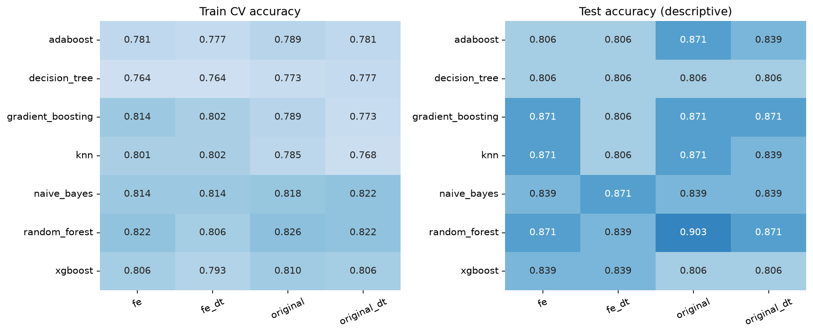

# Chẩn đoán bệnh tim bằng Machine Learning

[](https://www.python.org/)
[](https://scikit-learn.org/)
[](https://streamlit.io/)

Dự án học tập trên **Cleveland Heart Disease**, gồm quy trình xử lý dữ liệu,
so sánh mô hình, giải thích bằng TreeSHAP và demo dự đoán với Streamlit.

[Báo cáo đầy đủ](reports/final_report.md) · [Từ điển dữ liệu](docs/DATA_DICTIONARY.md) · [Hướng dẫn GitHub](docs/GITHUB_SETUP.md)

## Nội dung dự án

- **303 mẫu**, **13 đặc trưng đầu vào**, nhãn nhị phân: không bệnh / có bệnh.
- **Bốn biến thể:** Original, Feature Engineering (FE), Original + DT, FE + DT.
- **Bảy classifier chính:** Gaussian Naive Bayes, KNN, Decision Tree, Random Forest,
  AdaBoost, Gradient Boosting và XGBoost, tương ứng **28 cấu hình**.
- **Tám cấu hình bổ sung:** KMeans với ánh xạ nhãn học từ train và stacking KNN–DT–NB.
- Tiền xử lý và chọn đặc trưng được fit lại trong từng training fold để tránh rò rỉ dữ liệu.
- Đánh giá bằng accuracy, precision, recall, F1, ROC-AUC và confusion matrix.
- Phân tích lỗi từng mẫu, giải thích SHAP toàn cục/cục bộ và kiểm chứng additivity.
- Có kiểm thử, cấu hình Ruff và workflow GitHub Actions cho Windows/Ubuntu.

## Kết quả tham chiếu

Lần chạy tham chiếu dùng **seed 42**, chia phân tầng **242 / 30 / 31** mẫu cho
train/validation/test. **Random Forest + Original**, 50 cây và `max_depth=5`,
được chọn theo CV/validation trước khi báo cáo test.

| Chỉ số | Kết quả |
|---|---:|
| Accuracy CV 5-fold trên train, trung bình ± độ lệch chuẩn | 0,8263 ± 0,0181 |
| Accuracy validation | 96,67% |
| Accuracy test | **90,32%** |
| Precision lớp bệnh trên test | 86,67% |
| Recall lớp bệnh trên test | **92,86%** |
| F1 lớp bệnh trên test | 0,8966 |
| ROC-AUC test | 0,9286 |

Confusion matrix: **TN=15, FP=2, FN=1, TP=13**. Với 31 mẫu test, một dự đoán khác
đã làm accuracy đổi khoảng 3,23 điểm phần trăm. Các kết quả này mô tả thí nghiệm
học tập trên tập nhỏ, chưa khẳng định hiệu quả lâm sàng.

KMeans/stacking được bổ sung sau khi đã xem test của benchmark chính. Chúng được
báo cáo riêng như thí nghiệm khám phá hậu nghiệm, không thay đổi mô hình demo.



Xem [bảng kết quả](reports/results.csv), [phân tích lỗi](reports/error_analysis.csv)
và [báo cáo đầy đủ](reports/final_report.md). Đây là kết quả tham chiếu được lưu
trong repo; kết quả chạy lại có thể thay đổi theo phiên bản thư viện hoặc cấu hình.

## Cài đặt

Clone hoặc tải repository, mở terminal tại thư mục chứa `pyproject.toml`.
Cần **Python 3.11 trở lên**; môi trường tham chiếu dùng Python 3.11.

### Windows PowerShell

```powershell
python -m venv .venv
.\.venv\Scripts\python.exe -m pip install -e ".[all,dev]"
.\.venv\Scripts\python.exe scripts/check_project.py
```

### macOS / Linux

```bash
python3 -m venv .venv
source .venv/bin/activate
python -m pip install -e ".[all,dev]"
python scripts/check_project.py
```

Extra `all` cài các thư viện cho benchmark, SHAP, demo và notebook. Nếu chỉ chạy
kiểm thử dữ liệu/pipeline, cài `python -m pip install -e ".[dev]"` là đủ.
`requirements-lock.txt` ghi các phiên bản của môi trường tham chiếu Python 3.11.

## Chạy dự án và demo

Các lệnh dưới dùng `python` của môi trường đã kích hoạt. Trên Windows, có thể
thay bằng `.\.venv\Scripts\python.exe` mà không cần kích hoạt môi trường.

```bash
# Kiểm tra dữ liệu raw.
python -m heart_disease check-data

# Chuẩn bị dữ liệu, benchmark 28 cấu hình, đánh giá test và tạo biểu đồ SHAP.
python -m heart_disease run

# Chạy mô hình bổ sung và tạo báo cáo phân tích đầy đủ.
python -m heart_disease extensions
python -m heart_disease report

# Mở demo local.
python -m streamlit run app.py
```

Mở URL do Streamlit hiển thị, thường là `http://localhost:8501`, sau khi clone, cần chạy ít nhất
`python -m heart_disease benchmark` trước khi dùng demo. Demo nạp pipeline đã lưu;
bấm dự đoán không huấn luyện lại mô hình.

Có thể chạy riêng từng giai đoạn:

```bash
python -m heart_disease prepare
python -m heart_disease benchmark
python -m heart_disease evaluate
python -m heart_disease explain
python -m jupyterlab
```

Cấu hình nằm trong [experiment.toml](configs/experiment.toml), lưới siêu tham số
nằm trong [models.py](src/heart_disease/models.py). Phần diễn giải của báo cáo được
viết theo Cleveland/seed 42; khi đổi dữ liệu, seed hoặc model, cần đối chiếu lại
các ví dụ và kết luận thay vì giữ nguyên nhận xét cũ.

## Cấu trúc thư mục

```text
heart-disease-diagnosis-ml/
├── .github/workflows/ci.yml     
├── configs/                    # Cấu hình thực nghiệm
├── data/
│   ├── raw/cleveland.csv        
│   └── processed/              
├── src/heart_disease/           # Thuật toán và luồng ML/CLI
├── notebooks/                  
├── tests/                      
├── scripts/                    
├── docs/                       
├── reports/                    # Kết quả tham chiếu, biểu đồ, báo cáo
├── artifacts/                  
├── app.py                      
├── pyproject.toml              
├── requirements-lock.txt       
├── NOTICE.md                   
└── README.md
```

`.venv`, cache, file tạm, bản notebook đã chạy, model và các gói xuất PDF/ZIP
được giữ local, không đưa vào version control. `output/` cũng được gitignore.

## Phương pháp thực nghiệm

1. Nhãn gốc 0 giữ thành lớp 0; nhãn 1–4 gộp thành lớp 1.
2. Chia train/validation/test một lần, có phân tầng; dùng chung index giữa các biến thể.
3. Đặt imputer, scaler, ngưỡng nhóm tuổi, one-hot, MI và DT selector trong pipeline CV.
4. Tìm siêu tham số trên train; chọn theo CV mean, hòa điểm dùng validation F1.
5. Khóa lựa chọn chính rồi mới báo cáo test cho các cấu hình đã định trước.
6. Giữ kết quả KMeans/stacking riêng khỏi quá trình chọn mô hình chính.

CSV đã xuất dùng để kiểm tra/nộp bài; tuning dùng dữ liệu thô và pipeline đầy đủ.
Repeated CV trên train của cấu hình đã chọn chỉ mô tả độ ổn định, **không phải
nested CV của toàn bộ quá trình chọn mô hình**.

## Notebook

| Notebook | Vai trò |
|---|---|
| [00_eda](notebooks/00_eda.ipynb) | Chất lượng dữ liệu, missing và phân bố |
| [01_feature_variants](notebooks/01_feature_variants.ipynb) | Bốn biến thể và feature được chọn |
| [02_benchmark](notebooks/02_benchmark.ipynb) | CV, validation, test và phần mở rộng |
| [03_treeshap](notebooks/03_treeshap.ipynb) | Giải thích RF + Original |

Chạy theo thứ tự 00–03, chọn kernel của môi trường project. Các notebook sau cần
artifact từ những bước CLI tương ứng. Notebook source không lưu output; bảng và
biểu đồ tham chiếu có sẵn trong `reports/`.

## Nguồn

Dữ liệu: [UCI Heart Disease](https://archive.ics.uci.edu/dataset/45/heart+disease),
tập Cleveland.
