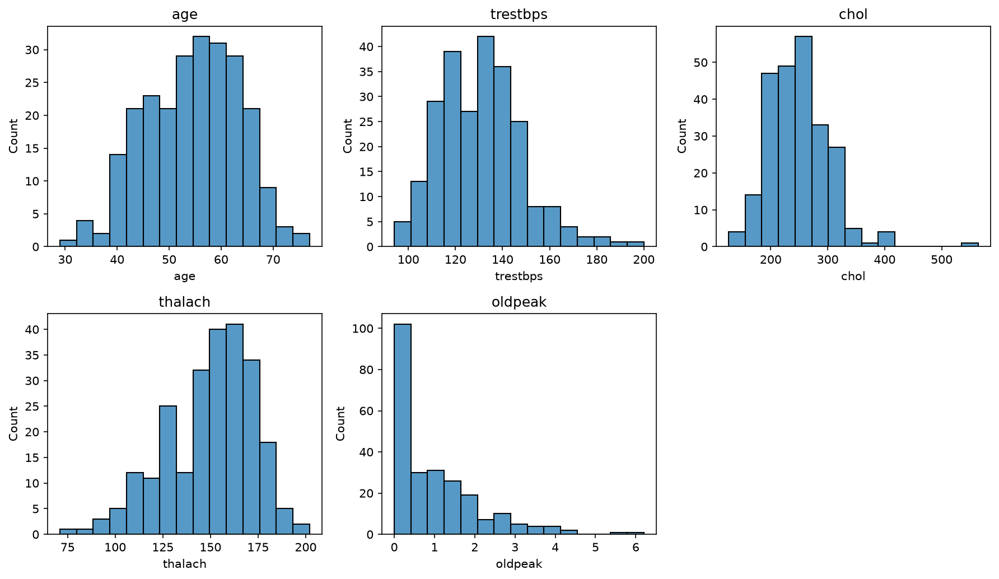
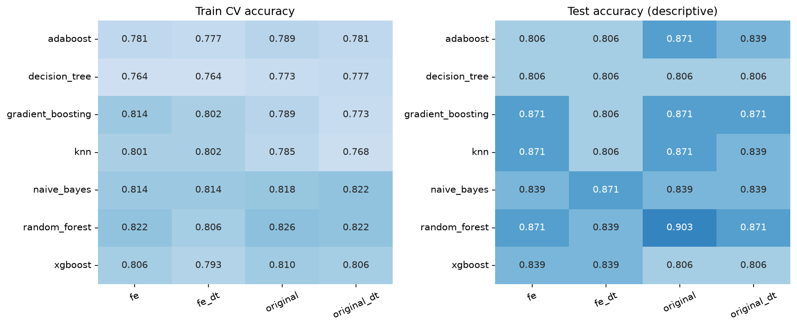
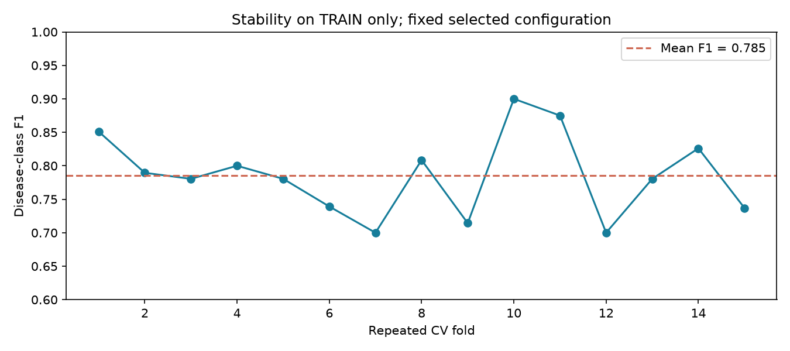
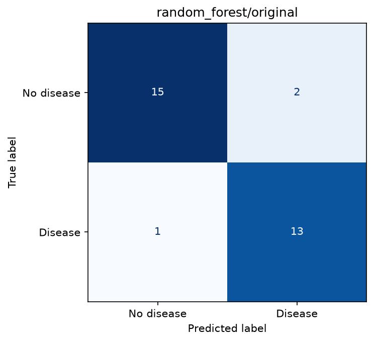
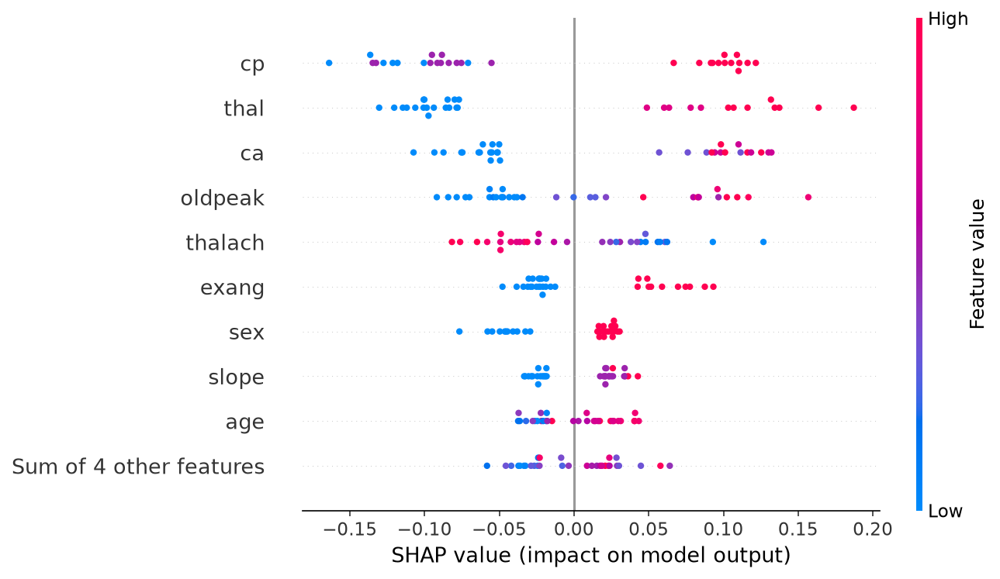
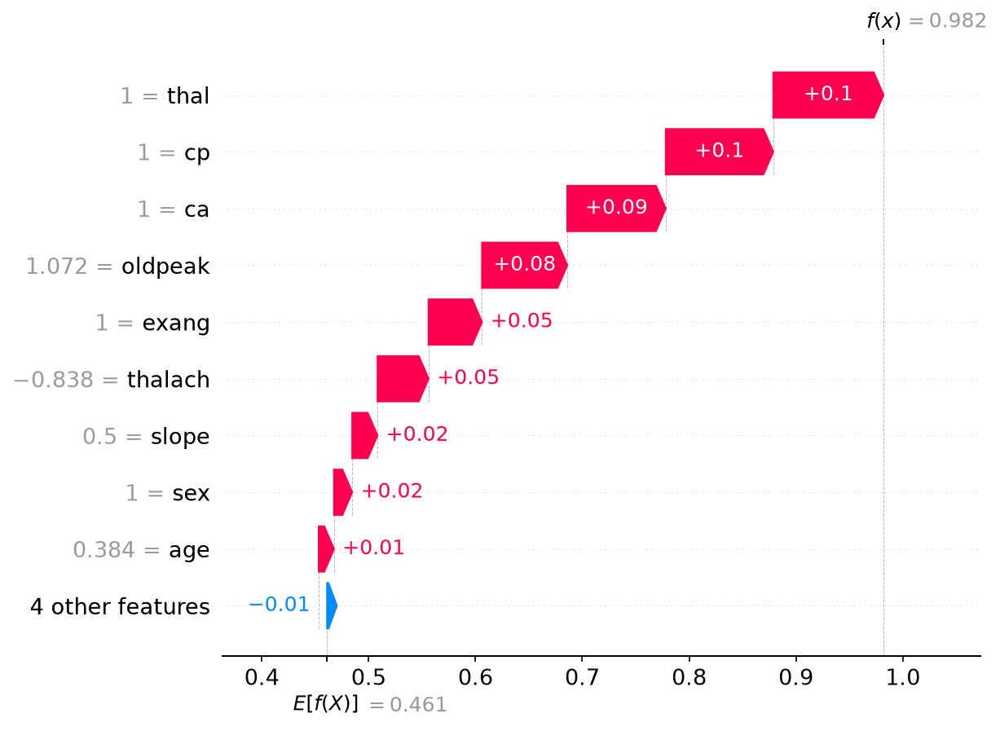
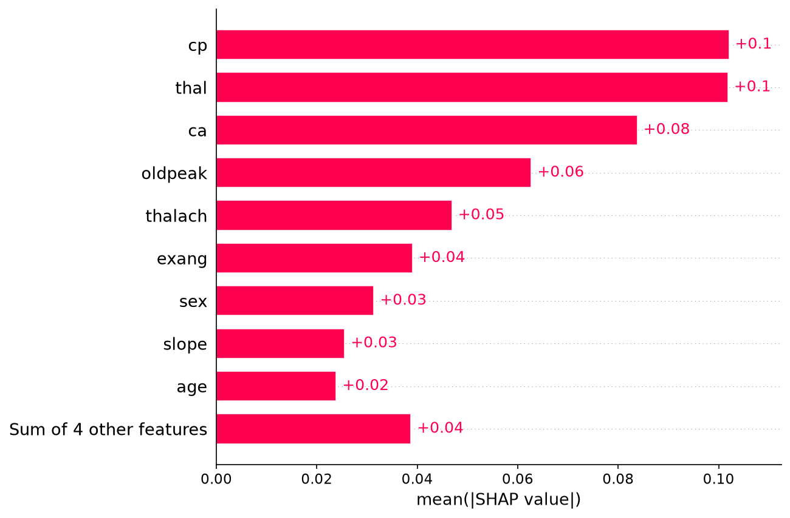

# Heart Disease Diagnosis

## Báo cáo hoàn chỉnh - Project AI 3.1

Bài toán: phân loại nhị phân bệnh tim trên Cleveland. Báo cáo sử dụng số đo thực từ run `20261102T164927743944Z` và phần mở rộng được ghi riêng. Không lấy kết quả minh họa trong tài liệu làm số đo của project.

**Kết quả chính.** Quy tắc chọn theo CV/validation chọn `random_forest/original` với CV accuracy 0.8263 ± 0.0181. Trên test: accuracy 0.9032, F1 lớp bệnh 0.8966, recall lớp bệnh 0.9286. Test có 31 mẫu; đây là kết quả học tập trên dữ liệu nhỏ.

**Phạm vi hoàn thành.** Đã triển khai bốn biến thể; bảy classifier chính (28 cấu hình); KMeans và stacking (8 cấu hình bổ sung); EDA; feature selection; test/error analysis; TreeSHAP; demo local; kiểm thử và hướng dẫn tái lập.

**Cách đọc.** Phần 1-3 mô tả dữ liệu/phương pháp, phần 4-6 trình bày kết quả và diễn giải, phần 7 ghi thí nghiệm mở rộng, phần 8-10 bàn giao và giới hạn. Bảng số liệu chi tiết ở results.csv, test_predictions.csv và thư mục artifact.

<!-- pagebreak -->

## 1. Dữ liệu, chất lượng và EDA

Dữ liệu local có 303 bệnh nhân, 13 feature và target. Nhãn gốc 0 giữ lớp 0; các nhãn 1-4 gộp thành lớp 1. Sau chuyển đổi có 164 mẫu lớp 0 (54,13%) và 139 mẫu lớp 1 (45,87%), mức chênh lệch chưa lớn. File có 4 giá trị thiếu ở ca và 2 ở thal; không có dòng trùng hoàn toàn. Giữ cả 303 mẫu, không xóa dòng thiếu; imputer được fit trên training subset.

| Tập | Số mẫu | Lớp 0 | Lớp 1 |
| --- | --- | --- | --- |
| train | 242 | 131 | 111 |
| val | 30 | 16 | 14 |
| test | 31 | 17 | 14 |

Thống kê bên dưới chỉ dùng train. Tuổi trung vị 56; huyết áp nghỉ trung vị 130; cholesterol trung vị 244,5. Cholesterol tối đa 564 và oldpeak tối đa 6,2 tạo đuôi phải; chưa có bằng chứng xác nhận lỗi nhập nên không tự loại hoặc cắt ngưỡng. Các cột cp/thal/slope là mã nhóm, không nên diễn giải như thang đo liên tục có khoảng cách y khoa đồng đều.

| Feature | Mean | Std | Min | Median | Max |
| --- | --- | --- | --- | --- | --- |
| age | 54.55 | 9.0 | 29.0 | 56.0 | 77.0 |
| trestbps | 130.96 | 17.62 | 94.0 | 130.0 | 200.0 |
| chol | 249.84 | 52.85 | 126.0 | 244.5 | 564.0 |
| thalach | 149.96 | 22.69 | 71.0 | 153.5 | 202.0 |
| oldpeak | 1.0 | 1.12 | 0.0 | 0.8 | 6.2 |

<!-- pagebreak -->

## 2. Bốn biến thể và tránh rò rỉ dữ liệu

Original dùng median + StandardScaler cho năm numeric; most_frequent + MinMaxScaler cho tám categorical. FE bổ sung chol/age, trestbps/age, thalach/age và age_bin từ quantile tuổi train; one-hot categorical; bỏ cột hằng theo train và giữ MI Top-13. Các biến thể có DT chọn Top-10 bằng feature_importances_.

| Biến thể | Số cột | Tên feature |
| --- | --- | --- |
| original | 13 | age, trestbps, chol, thalach, oldpeak, sex, cp, fbs, restecg, exang, slope, ca, thal |
| fe | 13 | thal_3.0, thal_7.0, cp_4.0, ca_0.0, exang_0.0, exang_1.0, oldpeak, slope_1.0, chol, slope_2.0, thalach, hr_ratio, sex_0.0 |
| original_dt | 10 | thal, cp, ca, oldpeak, chol, age, thalach, sex, slope, exang |
| fe_dt | 10 | thal_3.0, chol, hr_ratio, cp_4.0, thalach, ca_0.0, oldpeak, sex_0.0, slope_1.0, slope_2.0 |

MI đo phụ thuộc từng feature với nhãn; DT importance phụ thuộc các split của một cây và có thể chia sẻ thông tin giữa feature tương quan. Ví dụ exang_0.0 và exang_1.0 có cùng MI vì là hai mã bổ sung của cùng một biến; việc giữ cả hai không tạo hai bằng chứng độc lập. Trong Original+DT, trestbps/fbs/restecg không thuộc Top-10, không có nghĩa ba biến vô ích cho mọi mô hình.

Tất cả pipeline được fit lại trong mỗi training fold: imputer, scaler, ngưỡng age_bin, one-hot, MI và DT selector. Sau fit chỉ gọi transform trên val/test, giữ tên cột và thứ tự. 12 CSV được xuất để kiểm tra/nộp; CV vẫn nhận dữ liệu thô để tránh chọn feature theo nhãn toàn train trước CV. Feature trong bảng là kết quả fit cuối trên toàn train; các fold có thể chọn danh sách khác.

FE đồng thời thay mã hóa, tạo feature và chọn feature. Do đó nếu điểm thay đổi, chưa thể quy nguyên nhân riêng cho các tỉ lệ theo tuổi; cần ablation riêng để kết luận từng thành phần.

## 3. Giao thức benchmark

Chia stratified 80:10:10, seed 42; giữ index bệnh nhân gốc, các tập không giao nhau. Mỗi cấu hình dùng Stratified 5-fold CV trên train, scoring accuracy, refit best trên toàn train. Không refit trên val/test. Thứ tự chọn đã đặt trước: CV mean cao nhất, hòa điểm dùng validation F1, sau đó tên model/variant. Test chỉ dùng khi báo cáo cho danh sách cấu hình đã khóa.

| Model | Tham số quét |
| --- | --- |
| naive_bayes | {'var_smoothing': [1e-09, 1e-07]} |
| knn | {'n_neighbors': [3, 5, 9]} |
| decision_tree | {'max_depth': [3, 5, None]} |
| random_forest | {'n_estimators': [50, 100]} |
| adaboost | {'n_estimators': [50, 100]} |
| gradient_boosting | {'n_estimators': [50, 100]} |
| xgboost | {'n_estimators': [50, 100]} |

Các thiết lập cố định đáng chú ý: RF max_depth=5; GradientBoosting max_depth=2; XGBoost max_depth=3, learning_rate=0.05; estimator có hỗ trợ random_state dùng seed 42. Lưới được giữ nhỏ để chạy tái lập trên máy cá nhân, không khẳng định tối ưu toàn cục. Tham số tốt nhất từng cấu hình và điểm từng ứng viên lưu trong metadata/cv_results.csv.

<!-- pagebreak -->

## 4. Kết quả chính và so sánh

| model | variant | CV acc ± std | Val acc | Test acc | Test F1 | Recall 1 |
| --- | --- | --- | --- | --- | --- | --- |
| naive_bayes | original | 0.818 ± 0.031 | 0.900 | 0.839 | 0.839 | 0.929 |
| naive_bayes | fe | 0.814 ± 0.041 | 0.900 | 0.839 | 0.839 | 0.929 |
| naive_bayes | original_dt | 0.822 ± 0.020 | 0.933 | 0.839 | 0.839 | 0.929 |
| naive_bayes | fe_dt | 0.814 ± 0.019 | 0.867 | 0.871 | 0.867 | 0.929 |
| knn | original | 0.785 ± 0.029 | 0.900 | 0.871 | 0.857 | 0.857 |
| knn | fe | 0.801 ± 0.044 | 0.867 | 0.871 | 0.867 | 0.929 |
| knn | original_dt | 0.768 ± 0.050 | 0.933 | 0.839 | 0.839 | 0.929 |
| knn | fe_dt | 0.802 ± 0.021 | 0.900 | 0.806 | 0.800 | 0.857 |
| decision_tree | original | 0.773 ± 0.025 | 0.933 | 0.806 | 0.786 | 0.786 |
| decision_tree | fe | 0.764 ± 0.025 | 0.933 | 0.806 | 0.786 | 0.786 |
| decision_tree | original_dt | 0.777 ± 0.020 | 0.933 | 0.806 | 0.786 | 0.786 |
| decision_tree | fe_dt | 0.764 ± 0.025 | 0.933 | 0.806 | 0.786 | 0.786 |
| random_forest | original | 0.826 ± 0.018 | 0.967 | 0.903 | 0.897 | 0.929 |
| random_forest | fe | 0.822 ± 0.031 | 0.967 | 0.871 | 0.857 | 0.857 |
| random_forest | original_dt | 0.822 ± 0.021 | 0.933 | 0.871 | 0.857 | 0.857 |
| random_forest | fe_dt | 0.806 ± 0.010 | 0.900 | 0.839 | 0.815 | 0.786 |
| adaboost | original | 0.789 ± 0.048 | 0.900 | 0.871 | 0.867 | 0.929 |
| adaboost | fe | 0.781 ± 0.041 | 0.967 | 0.806 | 0.800 | 0.857 |
| adaboost | original_dt | 0.781 ± 0.049 | 0.967 | 0.839 | 0.839 | 0.929 |
| adaboost | fe_dt | 0.777 ± 0.048 | 0.967 | 0.806 | 0.800 | 0.857 |
| gradient_boosting | original | 0.789 ± 0.031 | 0.933 | 0.871 | 0.857 | 0.857 |
| gradient_boosting | fe | 0.814 ± 0.014 | 0.933 | 0.871 | 0.857 | 0.857 |
| gradient_boosting | original_dt | 0.773 ± 0.029 | 0.933 | 0.871 | 0.857 | 0.857 |
| gradient_boosting | fe_dt | 0.802 ± 0.022 | 0.933 | 0.806 | 0.786 | 0.786 |
| xgboost | original | 0.810 ± 0.009 | 0.900 | 0.806 | 0.786 | 0.786 |
| xgboost | fe | 0.806 ± 0.029 | 0.900 | 0.839 | 0.815 | 0.786 |
| xgboost | original_dt | 0.806 ± 0.018 | 0.967 | 0.806 | 0.786 | 0.786 |
| xgboost | fe_dt | 0.793 ± 0.014 | 0.900 | 0.839 | 0.815 | 0.786 |

Trong bảy mô hình, FE tăng CV mean so với Original ở 2/7 trường hợp; Original+DT tăng ở 2/7. KNN và GradientBoosting hưởng lợi về CV khi chuyển Original sang FE, trong khi RF không tăng. Với RF, Original có CV 0.8263; FE có CV 0.8222. Test giảm từ 0,9032 xuống 0,8710 khi chuyển RF Original sang FE hoặc Original+DT, và xuống 0,8387 ở FE+DT.

Kết quả cho thấy tạo/chọn feature không cải thiện nhất quán. Với tập nhỏ, one-hot và MI có thể thêm dư thừa hoặc loại feature có ích khi kết hợp; RF vốn đã chọn feature khi chia cây. Đây là các diễn giải phù hợp quan sát, chưa phải bằng chứng xác định cơ chế gây thay đổi. Baseline NB Original có test 0,8387, vì vậy lợi ích của RF cần đặt trong bối cảnh mô hình đơn giản đã có tín hiệu dự đoán.

## 4.1. So sánh trực quan và độ dao động

Heatmap dùng cùng thang màu để đối chiếu model/variant. Cột test chỉ mô tả các cấu hình đã khóa, không dùng để chọn lại mô hình. Biểu đồ repeated CV phía dưới chỉ dùng train và metric F1 lớp 1; các fold không độc lập hoàn toàn vì mẫu được tái sử dụng giữa các lần lặp.

Dao động F1 từ khoảng 0,70 đến 0,90 cho thấy kết quả phụ thuộc vào tập mẫu được giữ lại mỗi fold. Không chọn fold hoặc lần chia có điểm cao nhất làm kết quả đại diện. Chênh lệch nhỏ giữa các cấu hình cần được đọc cùng với biến động này và số mẫu ít.

<!-- pagebreak -->

## 5. Sai số, recall và độ ổn định

Confusion matrix của cấu hình đã chọn (hàng là nhãn thật, cột là dự đoán):

| Nhãn thật | Dự đoán 0 | Dự đoán 1 |
| --- | --- | --- |
| 0 - không bệnh | 15 | 2 |
| 1 - có bệnh | 1 | 13 |

Có 13 true positive, 15 true negative, 2 false positive và 1 false negative. Recall lớp 1 = 13/14 = 0.9286; precision lớp 1 = 13/15 = 0.8667. Accuracy cao không loại bỏ việc bỏ sót: dòng CSV 67 có nhãn 1 nhưng dự đoán 0, xác suất lớp 1 khoảng 0,3862.

| source_row_1based | true_label | prediction | disease_probability | error_type |
| --- | --- | --- | --- | --- |
| 93 | 0 | 1 | 0.8576 | FP |
| 67 | 1 | 0 | 0.3862 | FN |
| 272 | 0 | 1 | 0.6280 | FP |

Mẫu false negative có age=60, cp=3, thalach=155, oldpeak=3, ca=0, thal=3. Các đặc trưng có thể đưa tín hiệu khác chiều; quan sát một mẫu không đủ xác nhận nguyên nhân y khoa hoặc lỗi nhãn. Hai false positive ở dòng 93 và 272 cho thấy xác suất mô hình có thể cao nhưng vẫn sai. Giữ nguyên quy tắc quyết định đã fit; không chọn ngưỡng lại dựa trên ba lỗi test này.

Test chỉ có 31 mẫu; một lỗi làm accuracy đổi 3.23 điểm phần trăm. Khoảng Wilson 95% cho accuracy 28/31 xấp xỉ [0.751; 0.967], cho thấy bất định đáng kể. Khoảng này giả định các mẫu độc lập, không đo đầy đủ sai lệch do chọn mô hình hoặc khác biệt quần thể.

Repeated 5-fold x 3 trên TRAIN, với hyperparameter đã chọn, cho F1 trung bình 0.7855, std 0.0589. Đây là độ dao động mô tả trên cùng train, không phải nested CV hay một ước lượng hoàn toàn độc lập của toàn bộ quá trình lựa chọn. Không so trực tiếp F1 này với CV accuracy như cùng một metric.

<!-- pagebreak -->

## 6. TreeSHAP: toàn cục và một dự đoán

Giải thích Random Forest + Original, lớp 1, dùng tree-path-dependent: phân phối tham chiếu là số mẫu trên nhánh cây đã fit. Với RF classifier, raw tree output tương ứng xác suất từng lớp; code kiểm chứng trực tiếp với predict_proba. SHAP không phải classifier bổ sung và không chứng minh quan hệ nhân quả.

| Feature | Mean abs SHAP |
| --- | --- |
| cp | 0.1021 |
| thal | 0.1018 |
| ca | 0.0838 |
| oldpeak | 0.0627 |
| thalach | 0.0469 |
| exang | 0.039 |

Trên 31 mẫu giải thích, cp, thal và ca có mean absolute SHAP cao nhất; tiếp theo oldpeak và thalach. Mean absolute chỉ cho biết độ lớn, không có dấu. Beeswarm cho thấy một số giá trị mã cp/thal/ca cao thường nằm phía đóng góp dương trong nhóm mẫu này; vì đây là mã categorical và sample nhỏ, không suy diễn “mỗi đơn vị tăng” thành tác động liên tục hoặc kết luận cho mọi bệnh nhân.

Mẫu local có index gốc 62 (dòng CSV 63), age=58, cp=4, thal=7, ca=3, oldpeak=2,2, thalach=131. Đây là true positive có xác suất cao nhất trong số true positive, được chọn làm ví dụ dễ quan sát; không đại diện ngẫu nhiên cho toàn tập.

| feature | transformed_value | shap_value |
| --- | --- | --- |
| thal | 1.0000 | +0.1032 |
| cp | 1.0000 | +0.1007 |
| ca | 1.0000 | +0.0921 |
| oldpeak | 1.0716 | +0.0799 |
| exang | 1.0000 | +0.0500 |
| thalach | -0.8376 | +0.0478 |

Giá trị nền 0.4611 cộng tổng đóng góp thành 0.9820, đúng xác suất lớp 1; sai số lớn nhất toàn tập 3.33e-16. Trong mẫu này thal, cp, ca, oldpeak làm tăng đầu ra; thalach sau chuẩn hóa thấp hơn mức trung bình train cũng có đóng góp dương. Các trị số hiển thị trong waterfall là sau preprocessing, không còn đơn vị huyết áp/nhịp tim gốc.

<!-- pagebreak -->

## 7. Phần mở rộng: KMeans và stacking

Các thí nghiệm này được bổ sung sau khi đã xem test của benchmark chính, nên là phân tích khám phá hậu nghiệm, không phải so sánh xác nhận độc lập. Chúng không thay đổi selected_pipeline hoặc quy tắc lựa chọn chính. Cùng split/index, pipeline fit trong training fold, grid khóa trước khi chạy test mở rộng.

KMeans dùng hai cluster, n_init quét 10/20. Nhãn cluster được ánh xạ bằng tần suất lớp trong chính training subset; xác suất được làm trơn bằng prior train (smoothing=1). Đây là điểm tần suất theo cluster, không phải xác suất bệnh đã hiệu chỉnh. Không dùng nhãn val/test để ánh xạ cluster.

Stacking kết hợp KNN k=5, DT max_depth=5 và GaussianNB. Mỗi base learner có feature pipeline riêng; OOF 3-fold tạo đầu vào cho LogisticRegression. Outer CV 5-fold chọn C của meta learner trong 0,1/1,0. Không tiền xử lý toàn training subset trước OOF và không dùng dự đoán in-sample để học meta model.

| model | variant | CV acc ± std | Val acc | Test acc | Test F1 | Recall 1 |
| --- | --- | --- | --- | --- | --- | --- |
| kmeans | original | 0.707 ± 0.073 | 0.700 | 0.871 | 0.867 | 0.929 |
| kmeans | fe | 0.748 ± 0.031 | 0.800 | 0.871 | 0.867 | 0.929 |
| kmeans | original_dt | 0.703 ± 0.055 | 0.833 | 0.839 | 0.839 | 0.929 |
| kmeans | fe_dt | 0.727 ± 0.047 | 0.767 | 0.839 | 0.839 | 0.929 |
| stacking | original | 0.806 ± 0.038 | 0.933 | 0.839 | 0.839 | 0.929 |
| stacking | fe | 0.802 ± 0.022 | 0.900 | 0.839 | 0.839 | 0.929 |
| stacking | original_dt | 0.822 ± 0.020 | 0.933 | 0.839 | 0.839 | 0.929 |
| stacking | fe_dt | 0.797 ± 0.034 | 0.867 | 0.839 | 0.828 | 0.857 |

KMeans có test cao hơn mức CV trong một số biến thể, nhưng CV thấp và test nhỏ nên chưa có cơ sở xem clustering tốt hơn classifier chính. Stacking Original+DT có CV khoảng 0,8224, gần RF Original; test các stacking ở mức 0,8387. Thêm tầng mô hình không tự động tạo cải thiện. Do các thí nghiệm được bổ sung hậu nghiệm, các so sánh này chỉ dùng để hiểu phương pháp.

<!-- pagebreak -->

## 8. Demo và tái lập

Demo Streamlit nạp nguyên pipeline đã lưu, kiểm tra SHA-256 metadata, nhận 13 cột raw theo schema, gọi predict/predict_proba; không train lại khi submit. Xác suất là đầu ra của mô hình, chưa được hiệu chỉnh hay kiểm định lâm sàng.

| source_row_1based | true_label | prediction | disease_probability | error_type |
| --- | --- | --- | --- | --- |
| 63 | 1 | 1 | 0.9820 | TP |
| 102 | 0 | 0 | 0.0839 | TN |
| 67 | 1 | 0 | 0.3862 | FN |

Các ví dụ là hàng của test đã báo cáo, dùng để minh họa hành vi, không phải mẫu kiểm định mới. Toàn bộ 13 giá trị đầu vào có trong demo_examples.csv. Bảng trên là bằng chứng kiểm thử đầu vào/đầu ra của demo; các trị số xác suất được tính trực tiếp từ pipeline đã lưu.

Chạy local: `.venv/Scripts/python.exe -m streamlit run app.py`. Kiểm tra code: `.venv/Scripts/python.exe scripts/check_project.py`. Chạy lại từ đầu khi chủ động tạo thực nghiệm mới: `python -m heart_disease run`, sau đó `extensions` và `report`. Báo cáo PDF có script export riêng; xem README. Các notebook đã có nhận xét dựa trên run này, cần tạo lại report khi đổi dữ liệu/cấu hình.

## 9. Hạn chế, kết luận và hướng phát triển

Trong giao thức đã đặt, RF Original là cấu hình được chọn, đạt accuracy 0,9032 và recall lớp 1 0,9286 trên 31 mẫu test. Tuy nhiên dữ liệu nhỏ và lịch sử, một nguồn Cleveland, chưa có external validation; mọi kết luận chỉ áp dụng trong phạm vi thí nghiệm này. Lưới tham số nhỏ; chưa có nested CV của toàn bộ quá trình chọn model, ablation từng bước FE, phân tích theo nhóm hoặc đánh giá calibration. Đây là hướng phát triển, không phải những bước đã thực hiện.

Nếu tiếp tục nghiên cứu, đặt trước metric/không gian tìm kiếm, dùng nested/repeated CV hoặc tập đánh giá mới; không đổi seed/chọn ngưỡng theo test đã xem. Với bài học hiện tại, giá trị chính là quy trình tái lập, tránh rò rỉ dữ liệu, đánh giá nhiều metric và giải thích đúng giới hạn của mô hình.

<!-- pagebreak -->

## 10. Nguồn và phiên bản

1. Tài liệu môn học: Description - Project Heart Disease Diagnosis, các phần dữ liệu, bốn biến thể, benchmark, TreeSHAP và demo.
2. Slide-v1 - Project Heart Disease Diagnosis, pipeline và các mô hình mở rộng. Đường dẫn local được ghi trong docs/SOURCES.md.
3. UCI Heart Disease: https://archive.ics.uci.edu/dataset/45/heart+disease (nguồn bộ Cleveland; project sử dụng CSV local đã có).
4. scikit-learn common pitfalls: https://scikit-learn.org/stable/common_pitfalls.html
5. StackingClassifier: https://scikit-learn.org/stable/modules/generated/sklearn.ensemble.StackingClassifier.html
6. SHAP TreeExplainer: https://shap.readthedocs.io/en/latest/generated/shap.TreeExplainer.html
7. Streamlit AppTest: https://docs.streamlit.io/develop/api-reference/app-testing/st.testing.v1.apptest

| Thư viện | Phiên bản |
| --- | --- |
| numpy | 2.4.6 |
| pandas | 3.1.0 |
| scikit-learn | 1.9.1 |
| xgboost | 3.2.0 |
| shap | 0.51.0 |
| streamlit | 1.66.1 |
| joblib | 1.6.0 |

SHA-256 CSV gốc: `70a023033aaf840596737ad250eea055762ad825036ac73b5b29168dc638c7c2`. Phiên bản đầy đủ nằm trong requirements-lock.txt. Metadata lưu seed, split index, config hash và model hash. Báo cáo này là bản phân tích được tạo từ artifact thực; người nộp chịu trách nhiệm đọc, hiểu và đối chiếu yêu cầu hình thức của môn học.
